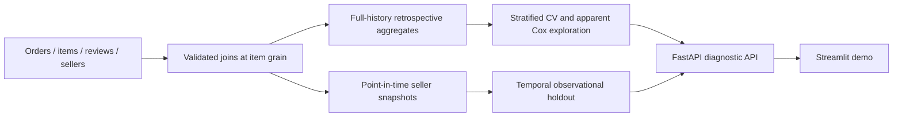

# Seller Quality Intelligence (offline research prototype)

A Python prototype for joining marketplace order data, constructing seller-level features, exploring retrospective seller-condition classification and Cox survival associations, and serving diagnostic scores through FastAPI and Streamlit.

> **Evaluation boundary:** this repository does not establish prospective seller-risk prediction, early warning, causal intervention benefit, or realized financial savings. Features and labels are aggregated over overlapping full seller histories. Classification metrics use stratified random-seller cross-validation and describe reconstruction of a retrospective rule-derived label. The Cox concordance in the generated report is apparent in-sample. Treat API scores as a demonstration, not operational decisions.

## Problem and data

The prototype uses the public Brazilian Olist e-commerce dataset, consisting of order, order-item, review, and seller tables. The loader joins at order-item grain and deduplicates reviews by order before joining. `SellerFeatureBuilder` aggregates records by seller and labels a seller at risk if their full-period mean review score is below 3.8, late-delivery rate exceeds 15%, or cancellation rate exceeds 5%.

This label describes a seller's observed historical state; it is not a future outcome. Some model inputs (such as delivery delay) are closely related to the rule's components, so high cross-validation metrics should not be interpreted as evidence of early warning. The data also has no intervention assignment or observed recovery counterfactual, so it cannot support ROI claims.

## Current evaluation

Run the pipeline to regenerate [`benchmark_report.json`](./benchmark_report.json). It reports stratified 5-fold seller-level CV for Logistic Regression and LightGBM on the retrospective label, plus an explicitly marked apparent in-sample Cox fit. The report intentionally excludes financial impact estimates. The existing report numbers should be regenerated from the checked-in pipeline before quoting them; do not copy older ROI, top-k precision, or hazard-ratio claims from prior project descriptions.

For an interview, describe the current work as a data integration and retrospective modeling prototype. A defensible prospective study would need a timestamped feature cutoff, features computed only before that cutoff, a prespecified future outcome window, a later temporal holdout, censoring rules, proportional-hazards diagnostics, uncertainty estimates, and intervention evidence before any savings claim.

### Point-in-time temporal benchmark

The repository now also contains a separate, more realistic retrospective benchmark:

```powershell
python scripts/evaluate_temporal.py
```

It creates seller snapshots at six historical cutoffs and uses only orders delivered by each cutoff for features. Review features are retained only when the review-answer timestamp is at or before that cutoff; an unknown timestamp makes the review unavailable. The label checks orders purchased in the following 90 days and observes delivery/review outcomes for up to 30 additional days. Only deliveries recorded by the end of that grace period contribute, so incomplete orders can bias observed risk; sellers without an observed future delivery are omitted. The training snapshots are from before 2018-01-01; the holdout cutoff is 2018-03-27. On the current local raw files, the latest holdout contains 379 seller snapshots (AP **0.632**, prevalence baseline **0.420**, ROC-AUC **0.669**); the 133 rows from sellers absent in training score AP **0.468** and ROC-AUC **0.635**. Regenerate these values with `python scripts/evaluate_temporal.py` before quoting them. Results are recorded in [`temporal_benchmark_report.json`](./temporal_benchmark_report.json), with rows in `data/processed/seller_temporal_snapshots.csv`.

These are retrospective observational estimates from one small historical extract, not prospective or operational validation. Incomplete future deliveries are not included in the outcome, and sellers with no observed delivered order are excluded. Snapshots can repeat the same seller across periods, so row-level metrics do not have independent observations and no uncertainty interval is claimed. The benchmark excludes cancellation rate as a feature because its point-in-time history contains completed deliveries only. No threshold, calibration, intervention effect, or financial benefit is established. The old full-history CV and apparent Cox results remain only for comparison and should not be presented as prediction evidence.

### Data provenance

The input files are from the public Brazilian Olist e-commerce dataset, locally provided under its applicable dataset terms; this repository does not download the data. The checked-in raw files are not committed to Git. The temporal evaluation is entirely observational and uses no synthetic records.

## Architecture



## Run locally

Python 3.10+ is recommended.

```powershell
python -m venv .venv
.venv\Scripts\Activate.ps1
pip install -r requirements.txt
python scripts/train_and_evaluate.py
pytest tests -q
```

The pipeline reads the Olist CSV files from `data/raw/`, writes the derived seller feature table to `data/processed/`, saves model artifacts under `models/`, and regenerates `benchmark_report.json`. Raw data and model binaries are ignored by Git; users must obtain the dataset under its applicable terms.

Start the demo services after running the pipeline:

```powershell
uvicorn api.app:app --host 127.0.0.1 --port 8000
streamlit run streamlit_app/app.py
```

FastAPI documentation is available at `http://127.0.0.1:8000/docs`.

## Repository map

- `src/data/loader.py`: input loading, joins, and order-level review deduplication.
- `src/features/builder.py`: seller aggregates and retrospective label construction.
- `src/models/`: Logistic Regression, LightGBM, Cox model, and diagnostic explanations.
- `src/evaluation/`: generic ranking and cost-matrix helpers. The current pipeline does not use them to claim business impact.
- `scripts/train_and_evaluate.py`: reproducible retrospective CV and exploratory fit.
- `api/`, `streamlit_app/`: local demonstration interfaces.
- `tests/`: loader, feature, model-artifact, and API checks.

## Known limitations and next research step

- The point-in-time benchmark is retrospective and has only six cutoffs, with one cutoff in the temporal test period.
- The rule-derived outcome is contemporaneous and partly encoded by related operational features.
- Random seller folds do not test temporal or marketplace-shift generalization.
- Cox metrics and hazard ratios from the full dataset are descriptive/apparent, not held-out survival performance or causal effects.
- Recommendations are heuristic playbooks, not measured interventions.
- API risk probabilities are not calibrated for prospective decisions or tied to a validated intervention threshold.

The next valid modeling iteration should create historical seller snapshots (for example, fixed monthly cutoffs), compute all features using records available by each cutoff, and label only outcomes in the following fixed horizon. Split by time, keep the latest period untouched until final evaluation, tune thresholds only on validation data, and compare against simple operational baselines. ROI should remain absent until a credible intervention effect and cost model are measured.
