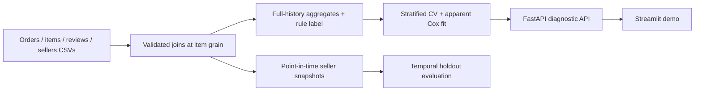

# Seller Quality Intelligence

[](https://github.com/sachin2967/seller-quality-intelligence/actions/workflows/ci.yml)


Seller-level analytics on the public Olist Brazilian e-commerce data: validated joins,
a point-in-time temporal benchmark, retrospective classification, Cox survival
associations, and a diagnostic FastAPI/Streamlit demo.

> **Evaluation boundary.** This is a retrospective, observational research prototype.
> It does not establish prospective seller-risk prediction, early warning, causal
> intervention benefit or realized savings. Scores are uncalibrated and the API
> recommendations are demonstration playbooks, not operational decisions.

## Highlights

- **Point-in-time snapshots:** features use only orders delivered by each cutoff, and
  review features only when the review-answer timestamp is at or before the cutoff.
  Outcomes cover orders purchased in the next 90 days, observed for up to 30 more days.
- **Temporal holdout:** six cutoffs, training snapshots before 2018-01-01, holdout at
  2018-03-27, plus a separate score for sellers never seen in training.
- **Honest comparison:** average precision is reported against prevalence, and the older
  random-seller CV and in-sample Cox results are labeled as non-predictive.
- **Failure-aware serving:** artifacts are published together, missing or invalid
  state returns `503`, responses carry their evaluation scope, and production mode
  requires an operator key.

## Results

### Temporal observational benchmark (`temporal_benchmark_report.json`)

1,215 seller snapshots from 552 sellers; 836 training rows, 379 holdout rows.

| Holdout | Rows | Prevalence | ROC-AUC | Average precision |
| --- | ---: | ---: | ---: | ---: |
| Latest cutoff (2018-03-27), all sellers | 379 | 0.420 | **0.669** | **0.632** |
| Sellers absent from training | 133 | 0.346 | 0.635 | 0.468 |

The model is class-weighted logistic regression on eight lookback features. Brier
score on the holdout is 0.227. Rows repeat sellers across periods, incomplete future
deliveries are excluded (which can bias observed risk), and no uncertainty interval,
calibration, threshold or intervention effect is claimed.

### Retrospective full-history benchmark (`benchmark_report.json`)

1,104 sellers, 401 labeled at-risk (36.3%). Stratified 5-fold random-seller CV on a
rule-derived label (mean review < 3.8, late-delivery rate > 15%, or cancellation
rate > 5%).

| Model | ROC-AUC | PR-AUC | F1 | Brier |
| --- | ---: | ---: | ---: | ---: |
| Logistic regression | 0.784 | 0.708 | 0.651 | 0.186 |
| LightGBM | 0.833 | 0.821 | 0.714 | 0.146 |

These numbers reconstruct a contemporaneous rule from related operational features
over overlapping histories. They are **not** evidence of early warning. The Cox
concordance (0.706, 526 events) is apparent in-sample and descriptive only.

## Architecture



See [docs/ARCHITECTURE.md](docs/ARCHITECTURE.md) and the [model card](docs/MODEL_CARD.md).

## Quickstart

Requires Python 3.11 and the four Olist CSVs from the
[Kaggle dataset](https://www.kaggle.com/datasets/olistbr/brazilian-ecommerce), obtained
under its terms and placed in `data/raw/` (not downloaded automatically, never committed):
`olist_orders_dataset.csv`, `olist_order_items_dataset.csv`,
`olist_order_reviews_dataset.csv`, `olist_sellers_dataset.csv`.

```bash
git clone https://github.com/sachin2967/seller-quality-intelligence.git
cd seller-quality-intelligence
python -m venv .venv && source .venv/bin/activate     # Windows: .\.venv\Scripts\Activate.ps1
pip install -r requirements.txt
make train       # retrospective CV, Cox fit, model artifacts, benchmark_report.json
make temporal    # point-in-time benchmark, temporal_benchmark_report.json
make api         # http://127.0.0.1:8000/docs
make dashboard   # Streamlit demo
make test        # lint + 23 offline tests
```

The tests create their own temporary fixtures and need no Olist files; `make train`
and `make temporal` do. Docker: put the CSVs in `data/raw/` and run
`docker compose up --build` (API on `8020`, dashboard on `8520`, loopback only).

## API

| Route | Purpose |
| --- | --- |
| `GET /live` | Process liveness |
| `GET /ready`, `/health` | Artifact readiness |
| `GET /api/summary` | Marketplace-level seller distribution |
| `GET /api/sellers/{seller_id}` | Diagnostic score, drivers and playbook (`404` if unknown) |
| `POST /api/score` | Score a hypothetical seller profile |

Every scoring response includes `evaluation_scope`, `score_interpretation` and
`action_scope` fields. `risk_probability` is a compatibility name for an uncalibrated
score, not a calibrated probability. Production mode (`APP_ENV=production`) requires a
32+ character `SELLER_API_KEY` sent as `X-API-Key`; bodies are capped at 64 KiB.
Operator authentication is not multi-user authorization; remote use needs TLS and
access controls. See [docs/OPERATIONS.md](docs/OPERATIONS.md).

## Repository layout

| Path | Responsibility |
| --- | --- |
| `src/data/loader.py` | CSV loading, validation, item-grain joins, review deduplication |
| `src/features/builder.py` | Seller aggregates and retrospective label |
| `src/evaluation/temporal.py` | Point-in-time snapshot construction |
| `src/models/` | Logistic regression, LightGBM, Cox model, explanations |
| `scripts/` | `train_and_evaluate.py`, `evaluate_temporal.py` |
| `api/`, `streamlit_app/` | Local demonstration interfaces |
| `tests/` | 23 offline tests: loader, features, temporal gating, models, API |

## Limitations

- One small historical extract, six cutoffs, and a single holdout cutoff.
- The rule-based label is contemporaneous and partly encoded by related features.
- Random seller folds do not test temporal or marketplace-shift generalization.
- Cox hazard ratios are descriptive associations, not held-out performance or causal effects.
- Recommendations are heuristic playbooks; no intervention was measured, so there is
  no ROI claim.
- The next valid step is repeated temporal holdouts with censoring treatment,
  calibration, survival diagnostics and intervention evidence.

## Related projects

[Fraud scoring](https://github.com/sachin2967/fraud-risk-scoring-pipeline) ·
[Model monitoring](https://github.com/sachin2967/model-monitoring-drift-platform) ·
[ADK commerce analyst](https://github.com/sachin2967/google-adk-multi-agent-analyst) ·
[LeetCode mentor](https://github.com/sachin2967/leetcode-knowledge-system) ·
[Portfolio guide](https://github.com/sachin2967/ml-portfolio)

## License

MIT. The Olist dataset keeps its own terms; do not redistribute it.
