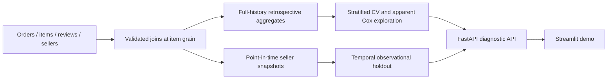

# Seller Quality Intelligence (offline research prototype)

A Python prototype for joining marketplace order data, constructing seller-level features, exploring retrospective seller-condition classification and Cox survival associations, and serving diagnostic scores through FastAPI and Streamlit.

> **Evaluation boundary:** this repository does not establish prospective seller-risk prediction, early warning, causal intervention benefit, or realized financial savings. Features and labels are aggregated over overlapping full seller histories. Classification metrics use stratified random-seller cross-validation and describe reconstruction of a retrospective rule-derived label. The Cox concordance in the generated report is apparent in-sample. Treat API scores as a demonstration, not operational decisions.

## Problem and data

The prototype uses the public Brazilian Olist e-commerce dataset, consisting of order, order-item, review, and seller tables. The loader joins at order-item grain and deduplicates reviews by order before joining. `SellerFeatureBuilder` aggregates records by seller and labels a seller at risk if their full-period mean review score is below 3.8, late-delivery rate exceeds 15%, or cancellation rate exceeds 5%.

This label describes a seller's observed historical state; it is not a future outcome. Some model inputs (such as delivery delay) are closely related to the rule's components, so high cross-validation metrics should not be interpreted as evidence of early warning. The data also has no intervention assignment or observed recovery counterfactual, so it cannot support ROI claims.

## Current evaluation

Run the pipeline to regenerate [`benchmark_report.json`](./benchmark_report.json). It reports stratified 5-fold seller-level CV for Logistic Regression and LightGBM on the retrospective label, plus an explicitly marked apparent in-sample Cox fit. The report intentionally excludes financial impact estimates. The existing report numbers should be regenerated from the checked-in pipeline before quoting them; do not copy older ROI, top-k precision, or hazard-ratio claims from prior project descriptions.

For an interview, describe the current work as a data integration and retrospective modeling prototype. A defensible prospective study would need a timestamped feature cutoff, features computed only before that cutoff, a prespecified future outcome window, a later temporal holdout, censoring rules, proportional-hazards diagnostics, uncertainty estimates, and intervention evidence before any savings claim.

### Point-in-time temporal benchmark

The repository now also contains a separate, more realistic retrospective benchmark:

```powershell
python scripts/evaluate_temporal.py
```

It creates seller snapshots at six historical cutoffs and uses only orders delivered by each cutoff for features. Review scores are available only when their answer timestamp is at or before the cutoff; unavailable reviews are masked without removing the order. Labels use purchases in the next 90 days with up to 30 additional observation days. Sellers without an observed future delivery are omitted. Training labels must mature before the first test cutoff, 2018-03-27. The preserved 12,000-order local subset gives 383 test sellers, AP **0.629** versus prevalence **0.418**, and AUC **0.659**. The 212 sellers absent from training have AP **0.512** and AUC **0.606**. Regenerate with `python scripts/evaluate_temporal.py`; see [the report](temporal_benchmark_report.json). The separate full-release study is below.

These are retrospective observational estimates from one small historical extract, not prospective or operational validation. Incomplete future deliveries are not included in the outcome, and sellers with no observed delivered order are excluded. Snapshots can repeat the same seller across periods, so row-level metrics do not have independent observations and no uncertainty interval is claimed. The benchmark excludes cancellation rate as a feature because its point-in-time history contains completed deliveries only. No threshold, calibration, intervention effect, or financial benefit is established. The old full-history CV and apparent Cox results remain only for comparison and should not be presented as prediction evidence.

### Expanded rolling study and official full dataset

The temporal builder now retains completed historical orders when their reviews
arrive after the cutoff, masking only the unavailable review. Training also purges
snapshots whose full outcome-observation window has not matured at prediction time.
These corrections are included in the regenerated subset
[report](temporal_benchmark_report.json) and both rolling studies.

```powershell
python scripts/evaluate_rolling.py
python scripts/download_olist.py
python scripts/evaluate_rolling.py --data-dir data/raw/official_v2 --output full_rolling_benchmark_report.json
```

The public download needs no Kaggle credential on the verified endpoint. It stores
the official v2 files separately from existing imports, verifies pinned observed
SHA-256 checksums and release row counts, and records provenance in the
[source manifest](docs/OLIST_SOURCE_MANIFEST.json). The release contains 99,441
orders, 112,650 items, 99,224 reviews and 3,095 seller records. Raw files stay ignored;
their CC BY-NC-SA 4.0 terms are separate from the code license.

The [full-data report](full_rolling_benchmark_report.json) contains 11 monthly
evaluation windows with expanding training and fully matured training labels.
It compares a fixed logistic model, historical late rate, historical low reviews
and training prevalence at a fixed 10% review capacity. Each window includes
500 seller-cluster bootstrap repetitions. The latest cutoff (2018-04-01) has
974 eligible sellers: AP 0.8065 versus prevalence 0.5883, AUC 0.7325, AP interval
[0.7736, 0.8377], and 93 adverse-outcome sellers among 98 reviewed (94.9% precision,
16.2% recall). The outcome means any observed adverse delivery/review in the next
90-day purchase window with 30-day grace; it depends on future order exposure.
This is an exploratory historical study with repeated sellers and overlapping
windows, selected observed deliveries and no causal/intervention claim. Intervals
do not cover future time periods or missing-outcome bias. These experimental
models do not replace the API's full-history retrospective diagnostic artifact.

### Data provenance

The input files are from the [Brazilian E-Commerce Public Dataset by Olist on Kaggle](https://www.kaggle.com/datasets/olistbr/brazilian-ecommerce). Obtain the files under the terms displayed by the source, place the four required CSVs in `data/raw/`, and do not commit or redistribute them. The optional download command above retrieves only the pinned public version into its own directory. The temporal evaluation is entirely observational and uses no synthetic records.

## Architecture



## Run locally

Python 3.10+ is recommended.

```powershell
python -m venv .venv
.venv\Scripts\Activate.ps1
pip install -r requirements.txt
python scripts/train_and_evaluate.py
pytest tests -q
```

Required raw files are `olist_orders_dataset.csv`, `olist_order_items_dataset.csv`, `olist_order_reviews_dataset.csv`, and `olist_sellers_dataset.csv`. The pipeline validates and reads them from `data/raw/`, writes the derived seller feature table to `data/processed/`, saves model artifacts under `models/`, and regenerates `benchmark_report.json`. Raw data and model binaries are ignored by Git.

Start the demo services after running the pipeline:

```powershell
uvicorn api.app:app --host 127.0.0.1 --port 8000
streamlit run streamlit_app/app.py
```

FastAPI documentation is available at `http://127.0.0.1:8000/docs`.

To start the containerized demo after putting the source files in `data/raw/`, run `docker compose up --build`. A one-shot training service builds artifacts before the API is considered ready; generated model and processed-data artifacts are kept in Docker named volumes. Both published ports bind to loopback (API `8020`, dashboard `8520` by default; override with `SELLER_API_PORT` / `SELLER_DASHBOARD_PORT`). Local mode is unauthenticated; production mode requires the operator key described below. Neither mode implements multi-user authorization or replaces external TLS/access controls.

## Repository map

### Serving pilot hardening

Production mode requires a 32+ character `SELLER_API_KEY`; clients send `X-API-Key`.
Bodies are bounded to 64 KiB. Artifact loading now publishes dependencies together;
missing/empty data, unavailable explainers and invalid model scores return 503.
Unknown sellers return 404 only when storage is available. `/live` checks the
process; `/ready` and `/health` check artifacts. API responses identify retrospective,
uncalibrated scope. The compatibility field `risk_probability` is not a calibrated
future probability. This adds operator authentication, not multi-user authorization;
remote use still needs TLS/access controls.

- `src/data/loader.py`: input loading, joins, and order-level review deduplication.
- `src/features/builder.py`: seller aggregates and retrospective label construction.
- `src/models/`: Logistic Regression, LightGBM, Cox model, and diagnostic explanations.
- `src/evaluation/`: generic ranking and cost-matrix helpers. The current pipeline does not use them to claim business impact.
- `scripts/train_and_evaluate.py`: reproducible retrospective CV and exploratory fit.
- `api/`, `streamlit_app/`: local demonstration interfaces.
- `tests/`: loader, feature, model-artifact, and API checks.

## Known limitations and next research step

- The point-in-time benchmark is retrospective and has only six cutoffs, with one cutoff in the temporal test period.
- The rule-derived outcome is contemporaneous and partly encoded by related operational features.
- Random seller folds do not test temporal or marketplace-shift generalization.
- Cox metrics and hazard ratios from the full dataset are descriptive/apparent, not held-out survival performance or causal effects.
- Recommendations are heuristic playbooks, not measured interventions.
- API risk probabilities are not calibrated for prospective decisions or tied to a validated intervention threshold.
- Docker startup requires the four source CSVs under `data/raw/`; the container does not download or bundle the dataset.

The next valid modeling iteration should create historical seller snapshots (for example, fixed monthly cutoffs), compute all features using records available by each cutoff, and label only outcomes in the following fixed horizon. Split by time, keep the latest period untouched until final evaluation, tune thresholds only on validation data, and compare against simple operational baselines. ROI should remain absent until a credible intervention effect and cost model are measured.

## Release verification and operations

The latest 22 November 2026 local verification passed **30 tests** and repository lint.
The earlier 23-test suite also passed from a temporary clean checkout without raw data or
model directories. Join/feature tests use authored temporary CSVs; classifier and
survival persistence tests train small synthetic fixtures and compare restored
outputs. These tests require no Kaggle credentials and do not reproduce Olist metrics.
The API image passed non-root, network-isolated artifact-backed readiness and serving checks. The dashboard reads artifacts directly and needs its own authenticated access proxy for remote use.

See the standalone [operations guide](docs/OPERATIONS.md) for configuration,
failure handling, recovery and rollout limits. Cross-project reports and replay tools
live in the separate [portfolio guide](https://github.com/sachin2967/ml-portfolio).
Hosted CI and cloud deployment are separate checks; a local pass does not imply either.
