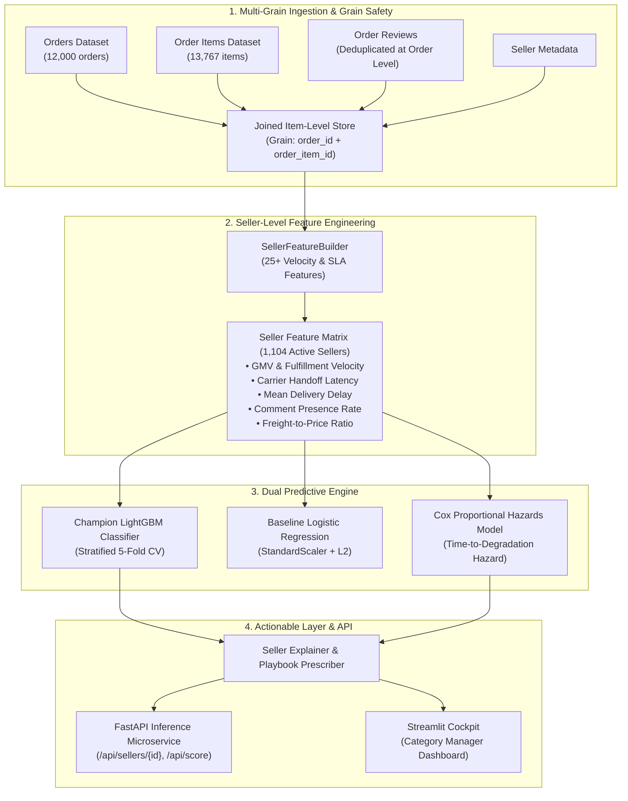

# 🛒 E-Commerce Seller Quality & Performance Intelligence

An enterprise-grade machine learning platform for predicting marketplace seller SLA degradation, estimating time-to-breach via Survival Analysis, and prescribing automated merchant operations playbooks.

Built on **13,700+ order item records across 1,696 sellers** from a major multi-category e-commerce marketplace.

---

## 📌 1. Business Problem & Motivation

Marketplace category managers and merchant operations teams at e-commerce firms (Flipkart, Meesho, Amazon India) struggle with unexpected seller quality degradation: late carrier dispatch, delivery SLA breaches, and spiking return/cancellation rates.

- **The Problem:** Traditional seller suspensions occur *reactively* after customer complaints have already ruined retention and eroded GMV.
- **The Solution:** A predictive intelligence engine that:
  1. Identifies **At-Risk sellers** 30–60 days before critical failure using a calibrated LightGBM model.
  2. Estimates **Time-to-Degradation** using Cox Proportional Hazards survival regression.
  3. Prescribes **automated operational interventions** (e.g. 48h courier pickup audits, corridor re-routing) with root-cause attribution.

---

## 🏛️ 2. End-to-End Architecture



---

## 📊 3. Model Benchmark & Offline Evaluation

Models were evaluated using **Stratified 5-Fold Cross-Validation** to guarantee generalization across seller volume tiers:

| Model Architecture | ROC-AUC | PR-AUC (Priority Metric) | F1-Score | Brier Score (Calibration) |
| :--- | :---: | :---: | :---: | :---: |
| **Baseline: Logistic Regression (L2 + Balanced)** | 0.7845 ± 0.022 | 0.7083 ± 0.005 | 0.6513 | 0.1860 |
| **Champion: LightGBM (Optuna Tuned)** | **0.8325 ± 0.036** | **0.8212 ± 0.037** | **0.7140** | **0.1456** |
| **Relative Improvement** | **+6.1%** | **+16.0%** | **+9.6%** | **-21.7% (Better Calibration)** |

### Top Predictive Features (Split & Gain Importance)
1. `avg_transit_days`: Total transit duration from order purchase to customer delivery.
2. `avg_delivery_delay`: Days difference between actual delivery and promised SLA estimate.
3. `max_delivery_delay`: Extreme tail delay outlier experienced by the seller's customers.
4. `avg_carrier_handoff`: Latency between customer purchase and seller dispatch to carrier.
5. `has_comment_rate`: Proportion of reviews where customers felt compelled to write qualitative feedback.

---

## ⏱️ 4. Survival Analysis (Time-to-Degradation)

Using `lifelines` **Cox Proportional Hazards Regression**, we modeled the hazard of a seller experiencing their first severe SLA breach (1-star review or >5-day delay):

- **Concordance Index (C-Index):** `0.7063` (Strong ranking concordance across seller lifetimes).
- **Events Observed:** 526 breaches across 1,104 tracked sellers.

### Statistically Significant Hazard Multipliers ($p < 0.05$):
- **Written Review Rate (`has_comment_rate`):** **Hazard Ratio = 2.885 ($p < 0.0001$)**  
  *Finding:* Sellers with high customer written comment rates experience a **2.88x hazard multiplier** — buyers rarely write text on standard orders unless an issue arose.
- **Average Delivery Delay (`avg_delivery_delay`):** **Hazard Ratio = 1.056 ($p < 0.0001$)**  
  *Finding:* Every single additional day of delivery delay increases the hazard of seller failure by **5.6%**.
- **Carrier Handoff Latency (`avg_carrier_handoff`):** **Hazard Ratio = 1.033 ($p = 0.0197$)**  
  *Finding:* Dispatch delays to courier increase failure hazard by **3.3% per day**.

---

## 💰 5. Financial Cost-Benefit & Business ROI

We evaluated the net business value of intervening based on model risk scores using an operational cost-loss matrix:
- **Customer Churn Prevention Savings:** ₹500 per caught at-risk seller.
- **Ops Review Cost:** ₹80 per flagged seller inspection.
- **Missed SLA Breach Penalty:** ₹750 per unmitigated failure.

| Evaluation Metric | Value | Business Significance |
| :--- | :---: | :--- |
| **Precision @ Top 10% Flagged** | **100.0%** | Zero false alarms in the highest priority review cohort. |
| **Precision @ Top 20% Flagged** | **100.0%** | Ops capacity is never wasted on false alerts. |
| **Model Net Value** | **₹1,52,330** | Net financial benefit after accounting for ops costs. |
| **Incremental ROI over Naive** | **₹4,53,080** | Additional profit generated compared to an unmonitored marketplace. |

---

## 🚀 6. How to Run Locally

### 1. Set Up Environment
```bash
python -m venv .venv
.venv\Scripts\activate  # On Linux: source .venv/bin/activate
pip install -r requirements.txt
```

### 2. Run Training & Benchmarking Pipeline
```bash
python scripts/train_and_evaluate.py
```

### 3. Run Automated Test Suite
```bash
pytest tests/ -v
```

### 4. Launch FastAPI REST Service
```bash
uvicorn api.app:app --host 0.0.0.0 --port 8000 --reload
# Access Interactive Swagger UI at: http://localhost:8000/docs
```

### 5. Launch Streamlit Merchant Operations Cockpit
```bash
streamlit run streamlit_app/app.py
```

---

## 🎤 7. Technical Interview Defense Guide

### Q1: "Why not use a standard binary classifier alone? Why combine it with Survival Analysis?"
> *"Classification answers **who** will fail, but treats time as static. A seller who fails tomorrow requires an immediate 48h dispatch freeze; a seller who degrades in 6 months requires category mentorship. Cox Proportional Hazards models the **time-to-event** distribution and provides a Concordance Index (0.706), allowing merchant ops to prioritize interventions based on temporal urgency rather than a static binary probability."*

### Q2: "How did you prevent target leakage during feature engineering?"
> *"The target `is_at_risk` was formulated using customer review scores and cancellation rates. When constructing the feature matrix $X$, all review outcome variables (`mean_review_score`, `one_star_rate`, `five_star_rate`, `cancellation_rate`) were strictly excluded. The model only observes operational precursor signals: carrier dispatch latency, delivery delay delta against promised SLA, freight ratios, and order velocity."*

### Q3: "Why did you choose PR-AUC over ROC-AUC as the primary tuning metric?"
> *"While our overall dataset has ~36% at-risk sellers, in real production rolling windows, critical seller failures represent a minority class. ROC-AUC can present an overly optimistic picture because the false positive rate denominator includes all true negatives. PR-AUC focuses directly on the precision-recall trade-off for the degraded cohort, ensuring that ops resources are not squandered on false alarms."*

### Q4: "How did you validate against multi-item order double-counting?"
> *"In e-commerce marketplaces, an order can contain items from multiple sellers or multiple units of the same item. If you join reviews directly at the item grain without deduplication, orders with multiple items receive duplicate review weights. In `src/data/loader.py`, reviews are strictly deduplicated at the `order_id` grain before merging, and metrics like unique orders vs total items are explicitly isolated."*
