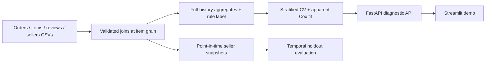

# Seller Quality Intelligence

[](https://github.com/sachin2967/seller-quality-intelligence/actions/workflows/ci.yml)


Seller-level analytics on the public Olist Brazilian e-commerce data: validated joins,
a point-in-time temporal benchmark, retrospective classification, Cox survival
associations, and a diagnostic FastAPI/Streamlit demo.

> **Evaluation boundary.** This is a retrospective, observational research prototype.
> It does not establish prospective seller-risk prediction, early warning, causal
> intervention benefit or realized savings. Scores are uncalibrated and the API
> recommendations are demonstration playbooks, not operational decisions.

## Highlights

- **Point-in-time snapshots:** retain orders delivered by the cutoff, and mask reviews
  with missing or later answer timestamps. Train only on snapshots whose purchase and
  outcome-observation windows have closed by the evaluation cutoff.
- **Temporal holdout and rolling validation:** the single holdout uses 2018-03-27,
  with an additional breakdown for sellers absent from training. The rolling study uses
  monthly cutoffs and a fixed review capacity.
- **Honest comparison:** average precision is reported against prevalence, and the older
  random-seller CV and in-sample Cox results are labeled as non-predictive.
- **Failure-aware serving:** artifacts are published together, missing or invalid
  state returns `503`, responses carry their evaluation scope, and production mode
  requires an operator key.

## Results

### Temporal observational benchmark (`temporal_benchmark_report.json`)

The full-release rerun uses the same 6 scheduled cutoffs
as the original benchmark and holds out 2018-03-27. The class-weighted logistic
regression uses 8 lookback features. Labels cover purchases over the next
90 days and outcomes observed through an additional 30-day grace period.

| Metric | Previously published extract | Original code, full release | Fixed code, full release |
| --- | ---: | ---: | ---: |
| Seller snapshots | 1,215 | 3,388 | 3,432 |
| Unique sellers across snapshots | 552 | 1,323 | 1,340 |
| Training rows | 836 | 2,435 | 1,604 |
| Holdout rows | 379 | 953 | 961 |
| Holdout prevalence | 0.4195 | 0.6034 | 0.6035 |
| Holdout ROC-AUC | 0.6687 | 0.7376 | 0.7370 |
| Holdout average precision | 0.6321 | 0.8123 | 0.8119 |
| Holdout Brier score | 0.2268 | 0.2058 | 0.2079 |
| Unseen-seller holdout rows | 133 | 221 | 450 |
| Unseen-seller prevalence | 0.3459 | 0.5385 | 0.5711 |
| Unseen-seller ROC-AUC | 0.6349 | 0.6817 | 0.7017 |
| Unseen-seller average precision | 0.4683 | 0.7467 | 0.7866 |

The published extract differs in coverage and prevalence from the full Olist release.
The two full-release columns use identical CSVs. Retaining delivered orders with
unavailable reviews changes eligible snapshots. Requiring mature training labels
reduces the training set and changes which sellers count as unseen.
The [comparison report](reports/temporal_migration_comparison.json) records the
source hashes, commands, and original-code rerun.

Rows repeat sellers across periods, and excluded incomplete future deliveries can
bias observed risk. The single holdout has no uncertainty interval, calibration,
tuned decision threshold, or intervention result.

### Retrospective full-history benchmark (`benchmark_report.json`)

1,104 → 2,462 sellers and
401 → 843 labeled at-risk
(36.3% → 34.2%) from the published
extract to the full release. Stratified 5-fold seller CV uses the same rule-derived
label (mean review < 3.8, late-delivery rate > 15%, or cancellation rate > 5%).

| Model | ROC-AUC, old → new | PR-AUC, old → new | F1, old → new | Brier, old → new |
| --- | ---: | ---: | ---: | ---: |
| Logistic regression | 0.784 → 0.793 | 0.708 → 0.699 | 0.651 → 0.637 | 0.186 → 0.182 |
| LightGBM | 0.833 → 0.826 | 0.821 → 0.769 | 0.714 → 0.659 | 0.146 → 0.156 |

The retrospective training code is unchanged by the temporal fix. These results
measure reconstruction of a contemporaneous rule from related operational features
over overlapping histories and establish no early-warning effect. Cox concordance
(0.706 → 0.666,
526 → 1,613 events) is apparent
in-sample and descriptive only.

### Rolling validation

The [rolling report](full_rolling_benchmark_report.json) records 11
eligible monthly windows. On the latest cutoff (2018-04-01),
974 sellers were evaluated. Training labels matured by
each cutoff, and review capacity was fixed at 10%.

| Method | Average precision | Precision at capacity | Recall at capacity |
| --- | ---: | ---: | ---: |
| Fixed logistic regression | 0.8065 | 0.9490 | 0.1623 |
| Historical late-delivery rate | 0.5900 | 0.4388 | 0.0750 |
| Historical low review score | 0.5967 | 0.5000 | 0.0855 |
| Constant training-prevalence score | 0.5883 | 0.5000 | 0.0855 |

The latest logistic-regression AP seller-cluster bootstrap interval is
0.7736–0.8377 at 95%. It describes uncertainty within that window. Overlapping
periods and repeated sellers preclude a pooled significance claim or inference to new
periods. The historical data has already been inspected.

```bash
make train
make temporal
python scripts/evaluate_rolling.py
```

## Architecture



See [docs/ARCHITECTURE.md](docs/ARCHITECTURE.md) and the [model card](docs/MODEL_CARD.md).

## Quickstart

Requires Python 3.11 and the four Olist CSVs from the
[Kaggle dataset](https://www.kaggle.com/datasets/olistbr/brazilian-ecommerce), obtained
under its terms and placed in `data/raw/` (not downloaded automatically, never committed):
`olist_orders_dataset.csv`, `olist_order_items_dataset.csv`,
`olist_order_reviews_dataset.csv`, `olist_sellers_dataset.csv`.

```bash
git clone https://github.com/sachin2967/seller-quality-intelligence.git
cd seller-quality-intelligence
python -m venv .venv && source .venv/bin/activate     # Windows: .\.venv\Scripts\Activate.ps1
pip install -r requirements.txt
make train       # retrospective CV, Cox fit, model artifacts, benchmark_report.json
make temporal    # point-in-time benchmark, temporal_benchmark_report.json
make api         # http://127.0.0.1:8000/docs
make dashboard   # Streamlit demo
make test        # lint and offline tests
```

The tests create their own temporary fixtures and need no Olist files; `make train`
and `make temporal` do. Docker: put the CSVs in `data/raw/` and run
`docker compose up --build` (API on `8020`, dashboard on `8520`, loopback only).

## API

| Route | Purpose |
| --- | --- |
| `GET /live` | Process liveness |
| `GET /ready`, `/health` | Artifact readiness |
| `GET /api/summary` | Marketplace-level seller distribution |
| `GET /api/sellers/{seller_id}` | Diagnostic score, drivers and playbook (`404` if unknown) |
| `POST /api/score` | Score a hypothetical seller profile |

Every scoring response includes `evaluation_scope`, `score_interpretation` and
`action_scope` fields. `risk_probability` is a compatibility name for an uncalibrated
score, not a calibrated probability. Production mode (`APP_ENV=production`) requires a
32+ character `SELLER_API_KEY` sent as `X-API-Key`; bodies are capped at 64 KiB.
Operator authentication is not multi-user authorization; remote use needs TLS and
access controls. See [docs/OPERATIONS.md](docs/OPERATIONS.md).

## Repository layout

| Path | Responsibility |
| --- | --- |
| `src/data/loader.py` | CSV loading, validation, item-grain joins, review deduplication |
| `src/features/builder.py` | Seller aggregates and retrospective label |
| `src/evaluation/temporal.py` | Point-in-time snapshot construction |
| `src/models/` | Logistic regression, LightGBM, Cox model, explanations |
| `scripts/` | Retrospective, single-holdout, and rolling evaluation |
| `api/`, `streamlit_app/` | Local demonstration interfaces |
| `tests/` | Offline tests for loader, features, temporal gating, validation, models, and API |

## Limitations

- One finite historical marketplace release. The single holdout and overlapping
  rolling windows cannot establish generalization to future periods.
- The rule-based label is contemporaneous and partly encoded by related features.
- Random seller folds do not test temporal or marketplace-shift generalization.
- Cox hazard ratios are descriptive associations, not held-out performance or causal effects.
- Recommendations are heuristic playbooks; no intervention was measured, so there is
  no ROI claim.
- Broader independent time periods, censoring treatment, calibration, survival
  diagnostics and intervention evidence remain outstanding.

## Related projects

[Fraud scoring](https://github.com/sachin2967/fraud-risk-scoring-pipeline) ·
[Model monitoring](https://github.com/sachin2967/model-monitoring-drift-platform) ·
[ADK commerce analyst](https://github.com/sachin2967/google-adk-multi-agent-analyst) ·
[LeetCode mentor](https://github.com/sachin2967/leetcode-knowledge-system) ·
[Portfolio guide](https://github.com/sachin2967/ml-portfolio)

## License

MIT. The Olist dataset keeps its own terms; do not redistribute it.
