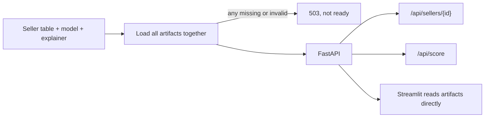

# Architecture

## Data

Four Olist CSVs (orders, order items, reviews, sellers) are validated and joined at
order-item grain. Reviews are deduplicated per order before joining so they do not
multiply item rows. Raw files stay in ignored `data/raw/`.

## Two evaluation tracks

**Retrospective full-history track** (`scripts/train_and_evaluate.py`)

1. `SellerFeatureBuilder` aggregates each seller over the whole period.
2. A seller is labeled at-risk if mean review < 3.8, late-delivery rate > 15%, or
   cancellation rate > 5%.
3. Logistic regression and LightGBM are scored with stratified 5-fold random-seller CV;
   a Cox model is fit in-sample for association only.
4. The champion model, explainer, survival artifact and processed seller table are
   saved together and served by the API.

This track reconstructs a contemporaneous rule and cannot show early warning.

**Point-in-time temporal track** (`scripts/evaluate_temporal.py`)

1. Snapshots are built at six cutoffs (2017-01-01 to 2018-03-27).
2. Features use only deliveries completed by the cutoff, and review features only when
   the review-answer timestamp is at or before it. Unknown timestamps mean the review
   is unavailable. Sellers need at least two historical orders.
3. The outcome looks at orders purchased in the next 90 days and observes deliveries
   and reviews for up to 30 more days. An observed delivery later than estimated, or a
   review of 2 or less, marks the snapshot positive. Sellers with no observed future
   delivery are omitted.
4. A class-weighted logistic regression trains on cutoffs before 2018-01-01 and is
   evaluated on the latest cutoff, with a separate slice for unseen sellers.

This track does not replace the served model.

## Serving

- Artifacts are published as a set; partial state returns `503`.
- Unknown sellers return `404` only when storage is available.
- Every scoring response carries `evaluation_scope`, `score_interpretation` and
  `action_scope`.
- Production mode needs `SELLER_API_KEY` (32+ characters); only load operator-trusted
  joblib files because deserialization can execute code.
